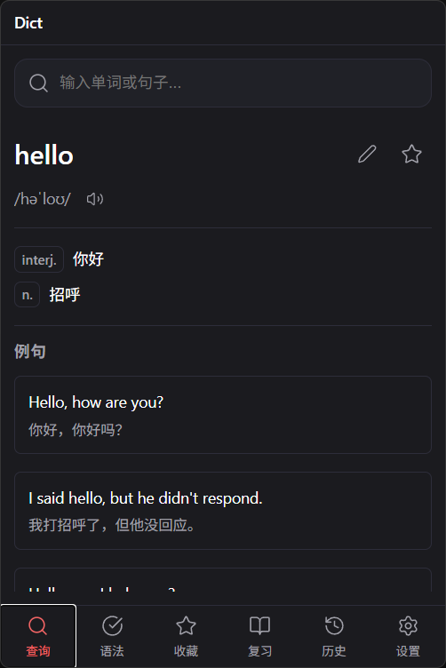
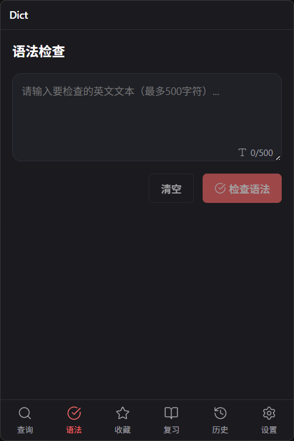
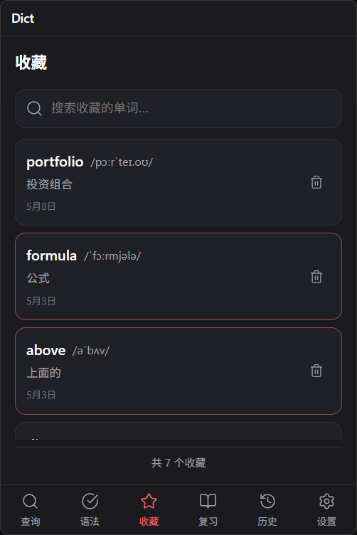
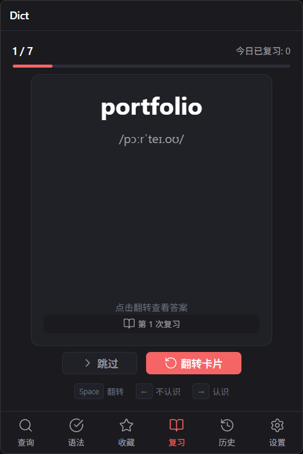
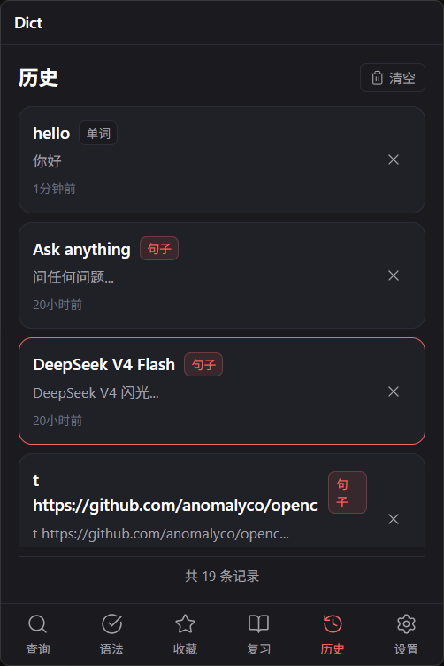
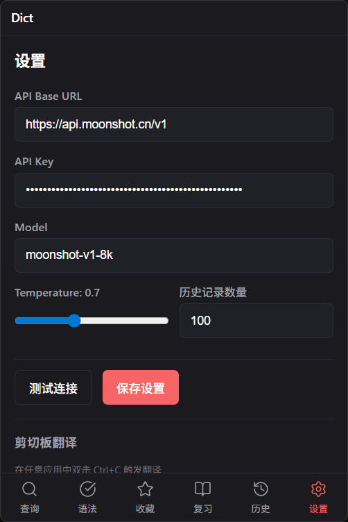

# dict - AI 词典工具

一个 AI 驱动的词典工具：输入单词或句子，由配置好的大模型按固定格式返回内容并渲染。

架构是「一个本机服务 + 两个客户端」——数据与 API Key 都在本机服务上，浏览器（bow）和 Android App 共用同一份数据。

```
bow 标签页 / Android App ──HTTP──> bun server (8471) ──> data/dict.db
                                              ├ /api/*      数据、设置、LLM 代理
                                              ├ /*          dist/ 静态页面
                                              └ /api/query  → 上游大模型（key 只在服务端）
```

## 功能特性

- 🔍 **单词查询** - 音标、词性、翻译、近义词/反义词、单词原型
- 🔊 **单词发音** - Web Speech API
- 📝 **语句翻译** - 自动识别单词 / 句子，支持中英互译
- ⭐ **收藏单词** - 搜索、复习评分、导出导入（JSON）
- 📚 **复习单词** - 卡片式翻转复习，「认识/不认识」调整掌握度
- 📝 **查询历史** - 自动保存，支持查看、单条删除、清空
- ✏️ **单词编辑** - 自定义翻译、例句、近反义词，添加个人批注
- 🧐 **语法检查** - 给出修正文本、逐条修改原因与整体评价
- 💾 **服务端缓存** - 查过的单词进 SQLite，重复查询免 API 调用，三端共享
- 🛰️ **断线接管** - 连不上服务器时进错误页，可改地址重试，每 5 秒自动探活

## Preview

|查询|语法|收藏|学习|历史|设置|
|-|-|-|-|-|-|
|||||||

## 技术栈

**客户端**

- Tauri v2 + Vue 3 + Vite + TypeScript
- 状态管理 Pinia、路由 vue-router（hash 模式）
- UI 组件库 [`@ruinb0w/ui`](../ui)（token 化的深色单主题，不引 Tailwind）
- 图标 `@lucide/vue`

**服务端**

- Bun 原生（`Bun.serve` + `bun:sqlite`），零框架依赖
- 数据库：SQLite 单文件 `data/dict.db`
- 不引入 ORM：JSON 型字段存 `doc` 列，用 `json_extract` 查询

## 快速开始

前置：**bun**（[安装](https://bun.sh/docs/installation)）、**Rust**（[rustup](https://rustup.rs/)，只在跑 Tauri 客户端时需要）。

```bash
bun install
bun run dev        # 一条命令起两个进程：vite(8470) + bun server(8471)
```

浏览器打开 **http://127.0.0.1:8470** 即可使用；进「设置」填大模型 API 地址 / Key / 模型后开始查询。

- dev 和 prod 的**服务端端口都是 8471**，开发时由 vite 把 `/api` 代理过去，所以页面永远同源。
- 数据在 `data/dict.db`（已 gitignore）——备份就是复制这个文件。
- 从旧版（纯客户端 IndexedDB）升上来时，在 **Android App** 的设置 → 数据管理 → 「迁移」一次性上传旧数据。

## 命令

```bash
bun run dev          # vite 8470 + server 8471（HMR 走 8472）
bun run serve        # 只起服务端：dist + /api 同源，端口 8471
bun run dev:android  # Android（devUrl 指 8470，需先跑 bun run dev）

bun run build        # vue-tsc --noEmit && vite build

bun run test         # vitest（前端）+ bun test server（服务端）
bun run typecheck    # vue-tsc --noEmit
```

`dev` 与 `serve` 不能同时跑（都占 8471）。

## 手机上用

服务端在局域网里被手机访问时加 `--bind 0.0.0.0`，然后在设置里填 `http://<本机 LAN IP>:8471`；出门走 tailscale 更省事：

```bash
tailscale serve --bg --https=8471 http://127.0.0.1:8471   # → https://<机器名>.<tailnet>.ts.net:8471
```

打包好的移动端 APK/iOS 是另一份 build（`VITE_API_BASE` 被写死），换网络时改设置里的服务器地址即可。

## 视觉风格

样式全部读 `@ruinb0w/ui` 的 token（`--bg-*` `--text-*` `--border-*` `--color-*` `--space-*` `--radius-*`），主题是唯一的深色 `exp1-dark`，项目里**不写十六进制色值、不引 Tailwind**。图标统一 Lucide 线性 1.5px。

## 开发环境补充

开发和构建**只在 WSL 里做**（Windows 侧的检出已废弃，不需要 MSVC 工具链）。

Android 出包额外需要：

- NDK：`/opt/android-sdk/ndk/27.3.13750724`
- `JAVA_HOME=/usr/lib/jvm/java-17-openjdk`
- 给 x86_64 模拟器出包用 `--target x86_64`
- `bun run dev:android` 里的 `--host` 必须是本机 LAN IP（`ip a` 看），否则手机/模拟器连不到 dev server

## Licence

本项目采用双重许可模式：

### 开源许可

本项目源代码在 [GNU Affero General Public License v3.0 (AGPL-3.0)](LICENSE) 下发布。

**核心要求：**

- ✅ 允许个人学习、研究使用
- ✅ 允许修改，但**修改后的项目必须开源**（相同许可证）
- ✅ 允许分发，但必须提供源代码
- ❌ **禁止闭源商用**（需获得商业许可）

### 商业许可

如需闭源使用或商业用途，请联系获得商业许可：

📧 **邮箱**: <ruinb0wman@gmail.com>

商业许可提供：

- 闭源使用权利
- 技术支持服务
- 专利授权保护
- 定制开发选项

---

## ⚠️ 重要声明

未获得书面商业许可前，任何商业使用、闭源集成均视为侵权。
